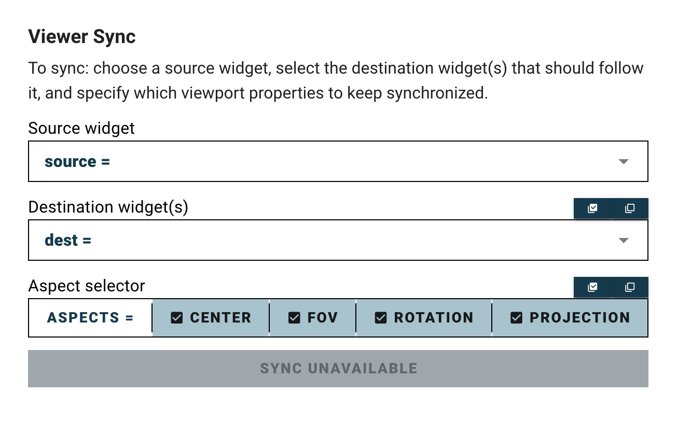

Plugins
=======

The ``mast-aladin`` package supports plugins that extend its functionality. Plugins provide
interoperability between `~mast_aladin.app.MastAladin` and other visualization tools
(e.g. `jdaviz <https://jdaviz.readthedocs.io/>`_).

Currently supported plugins
---------------------------
Currently we support the following plugin(s):

- Viewer Sync plugin (``viewer_sync``): synchronizes the viewport of
  `~mast_aladin.app.MastAladin` and ``jdaviz`` image viewers.

How to use
----------

The `~mast_aladin.managers.mast_manager.MastManager` class coordinates interactions
between components of the MAST Aladin ecosystem. It uses
`~mast_aladin.managers.app_manager.AppManager` to keep a registry of
visualization applications assigned to variables in your jupyter lab notebook, and a `~mast_aladin.managers.plugin_manager.PluginManager`,
which manages and displays the available plugins.

.. code-block:: python

    from mast_aladin import MastManager, MastAladin

    mast_manager = MastManager()

    mast_aladin_a = MastAladin()
    mast_aladin_b = MastAladin()

    mast_manager.display_plugins()

`~mast_aladin.managers.mast_manager.MastManager.display_plugins` displays all available
plugins in a tabbed widget. A single plugin can be displayed on its own with
`~mast_aladin.managers.mast_manager.MastManager.display_plugin`.

.. code-block:: python

    mast_manager.display_plugin("viewer_sync")

Application registration
^^^^^^^^^^^^^^^^^^^^^^^^

Plugins operate on the applications registered with the
`~mast_aladin.managers.app_manager.AppManager`. Applications are registered in two ways:

- **Automatic discovery**: after every notebook cell execution, the
  `~mast_aladin.managers.app_manager.AppManager` scans the notebook's global namespace
  for instances of `~mast_aladin.app.MastAladin` or ``jdaviz`` , and
  registers them under the variable names assigned to them in the notebook. In the example above, ``mast_aladin_a``
  and ``mast_aladin_b`` are discovered automatically.
- **Manual registration**: applications can be registered explicitly with
  `~mast_aladin.managers.mast_manager.MastManager.register_app`, which takes the
  application instance and a unique identifier. Manual registrations take precedence
  over automatically discovered applications with the same name.

.. code-block:: python

    mast_manager.register_app(mast_aladin_a, "my_viewer")

All registered applications can be opened side-by-side in
`sidecar <https://github.com/jupyter-widgets/jupyterlab-sidecar>`_ windows with
`~mast_aladin.managers.mast_manager.MastManager.display_apps`.

Viewer Sync Plugin
------------------

|

The Viewer Sync Plugin allows for the synchronization of the viewport between
`~mast_aladin.app.MastAladin` and jdaviz image viewers. This ensures that any changes
in the view, such as panning or zooming, are reflected across all synchronized viewers.

Currently supported viewer types for synchronization include:

- `~mast_aladin.app.MastAladin` image viewer
- ``jdaviz`` image viewer

Currently supported aspects for synchronization include:

- Viewport center
- Field of view
- Rotation angle
- Projection

.. note::
    Field of view is defined as the smaller of the width or height of the viewport.

Using the plugin
^^^^^^^^^^^^^^^^

To synchronize viewers from the plugin UI:

1. Choose a **source** viewer from the source dropdown. All other viewers follow the
   source.
2. Select one or more **destination** viewers that should follow the source. The source
   viewer cannot be selected as a destination.
3. Select which viewport **aspects** (center, field of view, rotation, projection)
   should be kept synchronized. The selection can be changed while syncing is active.
4. Toggle the **sync** switch to start real-time synchronization. The switch is enabled
   only once a source and at least one destination have been selected.

When synchronization starts, the destination viewers are immediately aligned to the
source, and subsequent changes to the source viewport are propagated to the
destinations in real time. Changing the source or destination selection stops the
active synchronization.

The dropdown options track the applications registered with the
`~mast_aladin.managers.app_manager.AppManager`, so newly created viewers become
available in the plugin automatically.

Limitations with jdaviz viewers
^^^^^^^^^^^^^^^^^^^^^^^^^^^^^^^

- A jdaviz application is only available for synchronization once it has an image
  viewer and its Orientation plugin has been configured to align by WCS with north up
  and east to the left. The plugin configures this automatically, which requires data
  to be loaded in the jdaviz viewer; until then, the viewer is disabled in the
  dropdowns.
- Projection synchronization is not supported in jdaviz: when a jdaviz viewer is a
  destination, the projection aspect is ignored.

